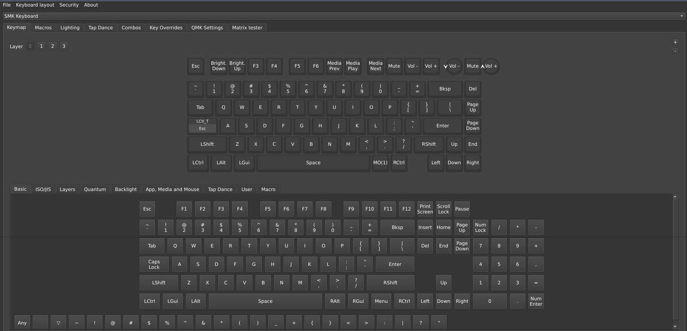

# Vial for the AULA F75, on SMK

Open firmware for the **Epomaker × AULA F75** that speaks **[Vial](https://get.vial.today/)**: remap
it, set up tap-hold, tap dance, combos, key overrides and lighting from Vial or
[vial.rocks](https://vial.rocks) in a browser — on Linux, macOS and Windows — and move your layout to
and from any other Vial keyboard. No vendor software, no JSON to load: the keyboard serves its own
definition.



This project is a **Vial layer on top of [SMK](https://github.com/karstx/smk)** and its
[AULA F75 port](https://github.com/Dozairu/smk_aulaF75). All the hard groundwork is theirs — see
[Credits](#credits).

## What it adds

- **Vial protocol 6** with VialRGB: the keyboard serves its compressed definition, unlock with Esc +
  Enter, keymap / layers / encoder / macros / matrix tester.
- **A QMK-style key engine** ([`src/smk/action.c`](src/smk/action.c), portable C, host-tested):
  layers (`MO TG TO DF TT LM OSL`), mod-tap / layer-tap with tapping term, permissive hold, hold on
  other key, retro tapping, quick tap; one-shot mods and layers; modded keycodes.
- **Tap dance** (8), **combos** (8), **key overrides** (4) — configured from Vial's tabs.
- **QMK settings**: tap-hold, combo term, one-shot keys, Grave Escape, Magic (NKRO, Caps/Ctrl,
  Alt/GUI, Ctrl/GUI swaps…).
- **Quantum keycodes**: `QK_BOOT`, `EE_CLR`, Caps Word, Repeat / Alt Repeat, Layer Lock, tri-layer,
  Grave Escape, Space Cadet, combo on/off, the RGB / RM lighting keys.
- **Lighting from Vial**: every Aula effect (single colour and rainbow), speed, brightness, colour.
- **Keep your setup across flashes** (`*_flash_keep`), or flash clean (`*_flash`).
- **Wireless fixes**: 2.4 GHz / Bluetooth reports wait for the radio module's ACK and a lost frame is
  healed — no dropped taps, no stuck auto-repeating keys.
- Smaller things: a clearer charging / full / low-battery status LED, `-Drgb_default_off`, a
  media-first F-row (`-Dfn_row_media`), indicator toggle keys.

Details: [docs/vial.md](docs/vial.md) · what's next: [docs/vial-roadmap.md](docs/vial-roadmap.md) ·
the keyboard port: [docs/keyboards/aula-f75.md](docs/keyboards/aula-f75.md).

## Quick start (AULA F75)

Keep a full backup of the stock firmware first (see the warning below), then:

```sh
nix develop
meson setup build-vial -Dvia=enabled -Dvial=enabled --buildtype=release \
      -Dautotype=false -Drf_diag=false
meson compile -C build-vial aula-f75_default_flash        # clean flash
meson compile -C build-vial aula-f75_default_flash_keep   # or: keep keymap and settings
```

Then open Vial (or [vial.rocks](https://vial.rocks) in a Chromium browser). Linux needs read/write
access to the keyboard's hidraw node; [docs/vial.md](docs/vial.md) has the udev rule.

It has been tested on one unit (classic F75). Hardware revisions may differ: proceed at your own risk.

## Credits

- **[SMK](https://github.com/karstx/smk)** by **Karolis Stasaitis ([karstx](https://github.com/karstx))**
  and contributors — the firmware this is built on: the SinoWealth 8051 platform, USB stack, ISP
  bootloader, build system and simulator tests, plus the
  [sinowisp](https://github.com/karstx/sinowisp) and [sinodude](https://github.com/karstx/sinodude)
  flashing tools. VIA / dynamic keymap support was started by aierm.
- **[smk_aulaF75](https://github.com/Dozairu/smk_aulaF75)** by **[Dozairu](https://github.com/Dozairu)**
  (with commits from james and Thaolia L.) — the AULA F75 port, reverse-engineered from a stock
  firmware dump: wireless (2.4 GHz / Bluetooth), the RGB engine and effects, encoder, battery,
  indicators, VIA menus.
- **[Vial](https://get.vial.today/)** and **[QMK](https://qmk.fm/)** — the protocol, GUI and the key
  behaviours this firmware follows, so layouts stay portable.

---

<div align="center">
  
</div>

# SMK - Small (device) Mechanical Keyboard Firmware

*The rest of this README is SMK's own (as of the AULA F75 port), describing the upstream project.*

[](https://github.com/karstx/smk/actions/workflows/build.yml) [](https://discord.gg/SZFBDBuxrK)

This is a keyboard firmware targeting SinoWealth 8051-based devices.

The S (Small) in SMK comes from this firmware using [SDCC](https://sdcc.sourceforge.net/) to build itself.

## ⚠️ WARNING ⚠️

You can very easily end up with a bricked device if the written firmware can't jump back into ISP mode, so before testing or modifying it, it's best to have a full dump of your stock firmware and a [programming tool](#programming-tools) that can write it back.

SMK ships [its own ISP bootloader](docs/bootloader.md), which takes that failure mode away: holding **S + M + K** while plugging the board in gets you into ISP mode whatever the firmware above it does. It has to go in over the programming interface once, and from then on the device is recoverable without opening the case.

## Supported Devices

| Keyboard | MCU | Wireless | Extra | Details |
| -------- | --- | -------- | ----- | ------- |
| NuPhy Air60 v1 | SH68F90A / BYK916 | 2.4G, BT (BDR+BLE) | | [Details](docs/keyboards/nuphy-air60.md) |
| E-YOOSO Z11 | SH68F90A / BYK901 | N/A | | [Details](docs/keyboards/eyooso-z11.md) |
| Genesis Thor 300 | SH68F881 / BYK801 | N/A | | [Details](docs/keyboards/genesis-thor-300.md) |
| CIY X77 | SH68F89 / BYK816 | N/A | External 24Cxx EEPROM | [Details](docs/keyboards/ciy-x77.md) |
| Epomaker × AULA F75 | SH68F90A / BYK916 | 2.4G, BT (BDR+BLE) | Rotary encoder, [Vial](docs/vial.md) | [Details](docs/keyboards/aula-f75.md) |

## Programming Tools

| Tool | Hardware | Interface | Notes |
| ---- | -------- | --------- | ----- |
| [sinowisp](https://github.com/karstx/sinowisp) | None, just USB | ISP | Writes the application through the board's ISP bootloader (stock or SMK's). Cannot write to the bootloader region, so it can't recover a board whose bootloader is gone or unreachable. |
| [sinodude](https://github.com/karstx/sinodude) + [sinodude-serial](https://github.com/karstx/sinodude/tree/main/firmware) | Arduino Nano (ATmega328P/PB) | ICP | Open source. Reads and writes the whole flash, including the bootloader. Used by the `*_full_flash` targets by default. |
| [sinodude](https://github.com/karstx/sinodude) + SinoLink | SinoWealth SinoLink dongle | ICP | Same as above, through the vendor's dongle. Select it with `-Dicp_programmer=sinolink`. |
| ProWriter + SinoLink | SinoWealth SinoLink dongle | ICP | SinoWealth's own Windows tool. Write `<board>_<layout>_full.hex` with it. |

Also: [ISP bootloader](docs/bootloader.md), [VIA](docs/via.md), [Vial](docs/vial.md). Platform notes: [SH68F90 / SH68F90A](docs/platforms/sh68f90.md), [SH68F881](docs/platforms/sh68f881.md), [SH68F89](docs/platforms/sh68f89.md).

## Developing

### Prerequisites

#### Nix

Currently, this project is primarily developed with the help of [Nix](https://nixos.org/) and Nix flakes. Please consider using Nix and the provided [flake](https://github.com/karstx/smk/blob/master/flake.nix) to automatically set up a reproducible development environment.

With Nix installed and flakes enabled, use `nix develop` or [direnv](https://direnv.net/) to enter a shell with all prerequisites installed.

### Building & Flashing

Once all prerequisites are set up, you can build and flash firmware for a specific combination of keyboard and layout using the following commands:

```sh
meson setup build # configure meson build dir
meson compile -C build nuphy-air60_default_smk.hex # build firmware for nuphy-air60 with the default layout
meson compile -C build nuphy-air60_default_flash # write firmware to the device via sinowisp
```

The same build produces `nuphy-air60_boot.hex` (SMK's ISP bootloader) and
`nuphy-air60_default_full.hex` (bootloader plus firmware), and
`nuphy-air60_default_full_flash` writes that over ICP with
[sinodude](https://github.com/karstx/sinodude). See
[docs/bootloader.md](docs/bootloader.md).

### Debug Console

Debug builds ship their log output as HID reports. `smk-console` ([tools/smk-console](tools/smk-console)) prints them, and runs on Linux, macOS and Windows:

```sh
cargo run --release --manifest-path tools/smk-console/Cargo.toml               # defaults to 05ac:024f (nuphy-air60)
cargo run --release --manifest-path tools/smk-console/Cargo.toml -- 258a:002a  # eyooso-z11
cargo run --release --manifest-path tools/smk-console/Cargo.toml -- 258a:001f  # genesis-thor-300
cargo run --release --manifest-path tools/smk-console/Cargo.toml -- 258a:0016  # ciy-x77
```

It picks devices up and drops them as they are plugged and unplugged, so it can be left running across a reflash. On Linux the `/dev/hidraw*` node needs a udev rule, or `sudo`.
